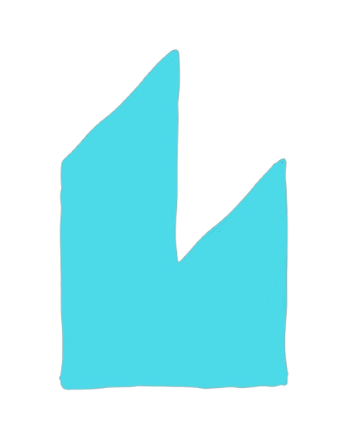

<p align="center">
  
</p>

<h1 align="center">dimui</h1>

<p align="center">
  <strong>Material-inspired component library for Dim — plus a Storybook-like explorer</strong>
</p>

<p align="center">
  No bundler, no TypeScript, no Dim npm install. Classic scripts + a tiny
  <code>BP</code> registry; Dim loads from the CDN at runtime.
</p>

<div align="center">

[**Live**](https://positive-intentions.github.io/dimui/) | [**dim**](https://github.com/positive-intentions/dim) | [**dimurl**](https://github.com/positive-intentions/dimurl) | [**dim-boilerplate**](https://github.com/positive-intentions/dim-boilerplate) | [**dimim**](https://github.com/positive-intentions/dimim)

</div>

<div align="center">


[](https://github.com/positive-intentions/dimui/actions/workflows/pages/pages-build-deployment)

</div>

---

**Docs:** [dimui on positive-intentions.com](https://positive-intentions.com/docs/projects/dim/dimui) · [Dim Getting Started](https://positive-intentions.com/docs/projects/dim/getting-started) · [Unit tests](https://positive-intentions.com/docs/projects/dim/unit-tests)

dimui is the **shared UI** for Dim apps: design-system atoms/molecules, a notes
kit, and a messaging kit. The explorer (sidebar, canvas iframe, addons) is a
custom Storybook-like shell with **no Storybook dependency**. Components
register with `BP.module("dimui/…", deps, factory)` and use `window.Dim`. Dim
loads from the
[GitHub Pages CDN](https://positive-intentions.github.io/dim/lib/).

## What it is

- **Design system** — atoms + generic molecules under `src/components/`
- **Notes kit** — `src/components/notes/` + `src/lib/notes/` (canonical UI for dim-boilerplate)
- **Messaging kit** — `src/components/messaging/` + `src/lib/messaging/` (presentational chat UI for dimim)
- **Explorer** — `src/explorer/` (sidebar, tree, preview-frame, addon-panel, kbd)
- **Stories / demos** — CSF modules in `src/stories/`; demos under `src/demos/` consume the kits

## Module inventory

### Theme

| Module | Tag / export | Notes |
|--------|--------------|-------|
| `dimui/theme` | `themeTokens`, `applyDocumentTheme`, … | Document `--dimui-doc-*` → host `--dimui-color-*`; includes bubble/ok vars |

Apps may keep `--notes-*` / `--chat-*` as **aliases** onto `--dimui-color-*` /
`--dimui-bubble-*` (see `dimui/lib/notes/tokens`, `dimui/lib/messaging/tokens`).

### Atoms (`dimui-*`)

`avatar`, `badge`, `button`, `chip`, `divider`, `empty-state`, `fab`, `icon`,
`icon-button`, `overlay`, `qty-stepper`, `qr-code`, `text-area`, `text-field`

### Generic molecules

| Module | Tag |
|--------|-----|
| `dimui/components/molecules/app-shell` | `dimui-app-shell` |
| `dimui/components/molecules/confirm-dialog` | `dimui-confirm-dialog` |
| `dimui/components/molecules/drawer` | `dimui-drawer` |
| `dimui/components/molecules/overflow-menu` | `dimui-overflow-menu` |
| `dimui/components/molecules/qr-scanner` | `dimui-qr-scanner` |
| `dimui/components/molecules/search-field` | `dimui-search-field` |
| `dimui/components/molecules/tabs` | `dimui-tabs` |
| `dimui/components/molecules/toolbar` | `dimui-toolbar` (library; unused by explorer today) |
| `dimui/components/molecules/unlock-screen` | `dimui-unlock` |
| `dimui/components/molecules/view-header` | `dimui-view-header` |

### Notes kit

| Module | Tag |
|--------|-----|
| `…/notes/molecules/folder-item` | `dimui-folder-item` |
| `…/notes/molecules/mobile-folder-bar` | `dimui-mobile-folder-bar` |
| `…/notes/molecules/note-item` | `dimui-note-item` |
| `…/notes/molecules/notes-header` | `dimui-notes-header` |
| `…/notes/organisms/folder-rail` | `dimui-folder-rail` |
| `…/notes/organisms/note-list` | `dimui-note-list` |
| `…/notes/organisms/note-editor` | `dimui-note-editor` |
| `…/notes/organisms/navigation-view` | `dimui-notes-nav` |
| `…/notes/organisms/notes-shell` | `dimui-notes-shell` |
| `…/notes/templates/notes-layout` | `dimui-notes-layout` |

Helpers: `dimui/lib/notes/{mockData,sharedKeys,note-filters,vault,tokens}`

### Messaging kit

| Module | Tag |
|--------|-----|
| `…/messaging/molecules/message-bubble` | `dimui-message-bubble` |
| `…/messaging/molecules/composer` | `dimui-composer` |
| `…/messaging/molecules/chat-header` | `dimui-chat-header` |
| `…/messaging/molecules/incoming-call-banner` | `dimui-incoming-call-banner` |
| `…/messaging/organisms/chat-thread` | `dimui-chat-thread` |

Helpers: `dimui/lib/messaging/{messages,tokens}`

### Explorer-only (`src/explorer/`)

`sidebar`, `tree`, `preview-frame`, `addon-panel`, `kbd` — not for app shells.

### Stays in apps

- **dim-boilerplate**: host chrome (`boilerplate-app`), PWA, page wrapper, e2e
- **dimim**: WebRTC/`chat-shell`, pairing, share-code, call-screen, meet-app, e2e

## Dim security notes

When using current Dim from the CDN:

- `renderChildren(string)` renders **text**, not HTML. Pass template results / slots for composition; use `unsafeHTML` only for trusted markup.
- Do not bind `onclick=` / `srcdoc=` / `.innerHTML=` — use `@click` and text/`unsafeHTML` instead.
- URL attributes (`href`, `src`, …) are sanitized (`javascript:` → `about:invalid#dim`).

See dim’s [MIGRATION.md](https://github.com/positive-intentions/dim/blob/HEAD/MIGRATION.md) and [SECURITY.md](https://github.com/positive-intentions/dim/blob/HEAD/SECURITY.md).

## Setup

```bash
git clone https://github.com/positive-intentions/dimui.git
cd dimui
```

## Run

Serve over HTTP (browsers need a real origin for multi-script pages and the Dim CDN):

```bash
python3 -m http.server 5173
```

Open [http://localhost:5173](http://localhost:5173).

- Manager: `index.html` → `<dimui-manager>`
- Canvas iframe: `preview.html` → `<dimui-preview>`
- Tests: `runTests.html` (DimTest + coverage)

## Tests

Open [`runTests.html`](./runTests.html) the same way as the explorer. CI runs
`.github/workflows/test.yml` against js + wasm via Playwright.

Useful flags: `?impl=js|wasm`, `?dimLib=…`.

## Runtime: JS or Rust/WASM

| URL | Runtime | Loads |
|-----|---------|-------|
| `/` or `?impl=js` | Pure JS (default) | `dim/lib/dim.global.js` |
| `?impl=wasm` | Rust core, wasm inlined | `dim/lib/dim.wasm.global.js` |

## URL flags

| Flag | Example | Meaning |
|------|---------|---------|
| `path` | `?path=/story/introduction-welcome` | Selected story |
| `nav` | `?nav=false` | Hide sidebar |
| `panel` | `?panel=false` / `?panel=right` | Hide panel or dock right |
| `full` | `?full=true` | Fullscreen canvas |
| `impl` | `?impl=wasm` | Dim runtime: `js` (default) or `wasm` |
| `dimurlSrc` | `?dimurlSrc=http://127.0.0.1:5180/src/` | Local dimurl while developing |

Notes shell declares hash paths with [dimurl](https://github.com/positive-intentions/dimurl) `<dimurl-router>` / `<dimurl-route>` and drives selection via `useParams` / `useNavigate` (`#/note/:id`, `#/folder/:id`).

## Layout

```
dimui/
  index.html / preview.html / runTests.html
  runtime.js
  src/
    theme.js
    components/
      atoms/
      molecules/          # design-system chrome
      notes/              # notes kit
      messaging/          # messaging kit
    lib/
      notes/
      messaging/
    explorer/             # Storybook-like shell widgets
    demos/                # thin consumers of kits
    stories/
```

## Consuming from dim-boilerplate / dimim

Apps load remote classic scripts, e.g. `dimui/components/atoms/button` →
`https://positive-intentions.github.io/dimui/src/components/atoms/button.js`.
Override while developing with `?dimuiSrc=http://127.0.0.1:5173/src/`.

Apps keep thin `BP.module` proxies under stable local ids (`notes/…`, `chat/…`)
so PWA precache lists and tests stay predictable.

## Adding a story

1. Create `src/stories/my-component.js` as `BP.module("dimui/stories/my-component", deps, factory)` returning CSF `{ default: { title }, NamedStory: { render } }`.
2. Add the module id to `src/registry.js` deps and the `modules` array.
3. Add `<script src="./src/stories/my-component.js">` to `index.html` / `preview.html` (before registry).
4. Refresh the explorer.
